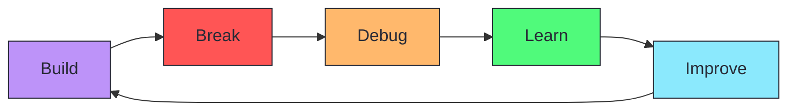

<div align="center">


<br>

<a href="https://git.io/typing-svg"></a>

</div>

---

<div align="center">

### 👾 SYSTEM ONLINE

</div>

> **Hey! I'm 2TimesVera** 👋
>
> I'm a PPLG student who enjoys building games, experimenting with code, and turning random ideas into actual projects.
>
> My main playground right now is **Roblox Studio**, where I'm learning how to create interactive experiences with Luau.

---

## 🎮 MAIN PROJECT

<div align="center">

### **🕹️ Roblox Studio Game Development**

</div>

```yaml
Platform:      Roblox
Engine:        Roblox Studio
Language:      Luau
Status:        🚧 In Development
```

<details>
<summary><b>📋 Project Details</b></summary>

<br>

**Game Name:** `[To be announced]`

**Description:**  
Work in progress. Building interactive game experience using Roblox Studio.

**Genre:** `[TBD]`

**Features:**
- 🎯 Interactive gameplay mechanics
- 🎨 Custom UI/UX design
- 🧠 Luau scripting
- 🌍 World building

**Progress:**
```
Planning        ████████░░  80%
Development     ██████░░░░  60%
Testing         ███░░░░░░░  30%
Release         ░░░░░░░░░░  00%
```

**Links:**
- 🎮 Roblox Game: `[Coming soon]`
- 📂 Repository: `[Private]`

</details>

---

## ⚡ TECH STACK

<div align="center">

### **🎮 Game Development**


### **🌐 Web Development**


### **🛠️ Tools & Environment**


</div>

---

## 🧠 CURRENTLY LEARNING

```yaml
🎮 Roblox Game Development      ███████░░░  70%
💻 Luau Scripting               ██████░░░░  60%
🌐 Web Development              █████░░░░░  50%
🤖 AI & Automation              ████░░░░░░  40%
🐧 Linux                        █████░░░░░  50%
```

<sup>*Progress bars are visual representation, not official statistics</sup>

---

## 🚀 FEATURED PROJECTS

<div align="center">

<table>
<tr>
<td width="50%">

### 🎮 Roblox Game
**Main Development Project**

Building interactive game experience in Roblox Studio using Luau scripting.

**Stack:** Roblox Studio, Luau  
**Status:** 🚧 In Development

`[View Project](PROJECT_URL)`

</td>
<td width="50%">

### 🌐 Web Project
**Full Stack Application**

Web application project using modern web technologies.

**Stack:** HTML, CSS, JavaScript, PHP  
**Status:** 🚧 In Development

`[View Project](PROJECT_URL)`

</td>
</tr>
<tr>
<td width="50%">

### 🗃️ Student Management System
**PHP + MySQL Project**

Database-driven application for managing student data and information.

**Stack:** PHP, MySQL, HTML, CSS  
**Status:** ✅ Completed

`[View Project](PROJECT_URL)`

</td>
<td width="50%">

### 🤖 AI Project
**Automation & AI**

Exploring AI tools and automation scripts.

**Stack:** Python, AI APIs  
**Status:** 🔬 Experimental

`[View Project](PROJECT_URL)`

</td>
</tr>
</table>

</div>

---

## `$ github --stats`

<div align="center">


</div>

<div align="center">


</div>

---

## 🐍 Contribution Activity

<div align="center">

<picture>
  <source media="(prefers-color-scheme: dark)" srcset="https://raw.githubusercontent.com/2TimesVera/2TimesVera/output/github-contribution-grid-snake-dark.svg">
  <source media="(prefers-color-scheme: light)" srcset="https://raw.githubusercontent.com/2TimesVera/2TimesVera/output/github-contribution-grid-snake.svg">
  
</picture>

<sup>*If snake animation not visible, contribution data still loading*</sup>

</div>

---

## 📡 SYSTEM STATUS

```bash
> SYSTEM STATUS

[✓] Learning
[✓] Building
[✓] Experimenting
[✓] Debugging
[!] Sleep.exe not found
[✓] Coffee.exe running
```

---

## 🧪 DEVELOPER MINDSET

<div align="center">



**Build → Break → Debug → Learn → Improve → Repeat**

</div>

---

## 💭 QUOTE

<div align="center">

> *""Experience is the name everyone gives to their mistakes."*
>
> **— Oscar Wilde**

</div>

---

## 📡 CONNECT WITH ME

<div align="center">

[](https://github.com/2TimesVera)

**Other Platforms:**

🎮 Roblox: `@Helcurt_1123`  
💬 Discord: `@izumii_houjou`  
📷 Instagram: `@heya6_4`  
📧 Email: `zackyganteng568@gmail.com`  
🌐 Portfolio: `Coming Soon`

</div>

---

<div align="center">
  
Thanks for visiting my profile! 🦇

<sub>Powered by curiosity, code, and too many ideas.</sub>

<div align="center">

<sub>© 2026 2TimesVera — All rights reserved.</sub>

</div>

</div>


</div>
